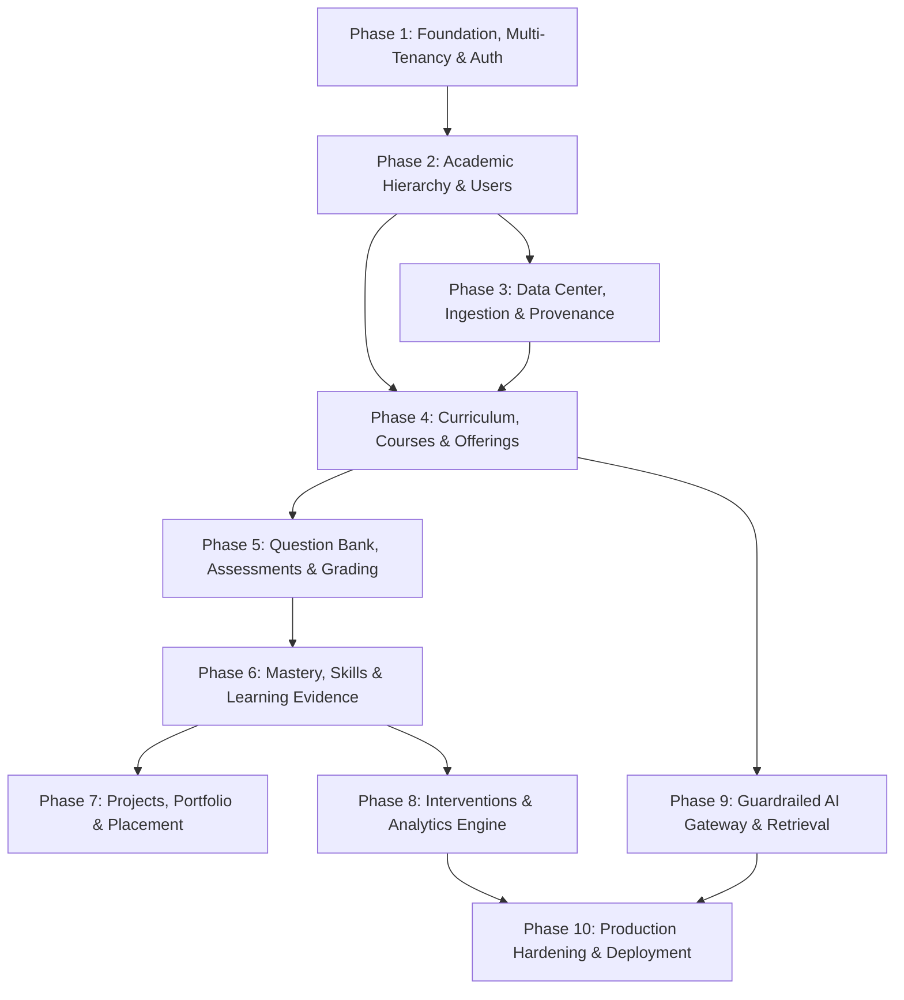

# DHRUVA.AI (V2) — IMPLEMENTATION ROADMAP & PHASE SPECIFICATION

> **Status:** Implementation Blueprint  
> **Prerequisite:** [DHRUVA_V2_MASTER_ARCHITECTURE.md](file:///c:/Users/sutan/OneDrive/Desktop/Dhruva%20V2/docs/DHRUVA_V2_MASTER_ARCHITECTURE.md)  
> **Standard:** Production-Grade / Zero Mock Data / Independently Testable  

---

## Roadmap Overview & Dependency Graph

---

## Phase 1: Multi-Tenant Foundation, Database RLS & Authentication

### 1. Objective
Establish the repository skeleton, PostgreSQL 16 database connection with `pgvector`, Row-Level Security (RLS) enforcement, user identity, Argon2id password hashing, rotating JWT/cookie session handling, and foundational RBAC.

### 2. Dependencies
None.

### 3. Database Changes
- Initial Alembic migration:
  - `institutions` (id, slug, legal_name, domain, status, settings, timestamps)
  - `users` (id, institution_id, email, password_hash, first_name, last_name, phone, status, timestamps, deleted_at)
  - `roles` (id, institution_id, name, code, description, permissions, is_system_role, timestamps)
  - `user_roles` (id, user_id, role_id, institution_id, context_department_id, granted_at, granted_by)
- Enable Postgres extension `pgvector` and `uuid-ossp`.
- Configure session variable `app.current_institution_id` and initial RLS policies.

### 4. Backend Changes
- Setup FastAPI async application structure (`src/domain`, `src/application`, `src/infrastructure`, `src/interfaces`).
- SQLAlchemy 2.0 async engine and session factory with connection pool listener setting `SET LOCAL app.current_institution_id`.
- Tenant identification middleware (via domain header or path slug).
- Argon2id password hasher service and JWT token issuer (15-min access token + 7-day refresh token in Redis).
- Dependency injection guards: `get_current_user`, `require_permission(perm_code)`, `get_current_tenant`.

### 5. API Changes
- `POST /api/v1/auth/login`
- `POST /api/v1/auth/refresh`
- `POST /api/v1/auth/logout`
- `GET /api/v1/auth/me`
- `GET /api/v1/platform/health`
- `GET /api/v1/platform/ready`

### 6. Frontend Changes
- Next.js 15 App Router setup with custom design tokens in CSS variables.
- Authentication provider & TanStack Query client configuration.
- Login screen supporting loading, success, invalid credentials, and account locked states.
- Global application layout with responsive navigation shell.

### 7. Tests
- Unit: Password hashing, token generation, permission bitmask evaluation.
- Integration: User login flow, token rotation, tenant context isolation.
- Security: Cross-tenant query assertion (User A in Tenant 1 cannot fetch Tenant 2 records).

### 8. Security Checks
- Verify `Secure`, `HttpOnly`, `SameSite=Strict` cookie headers.
- Rate limiting active on `/auth/login` (5 attempts per IP/minute).
- RLS enabled and tested against raw SQL leaks.

### 9. Acceptance Criteria
- Complete authentication flow working without mocks.
- Cross-tenant data isolation verified with failing test if RLS is bypassed.
- Healthcheck endpoints return 200 OK with database connection latency.

### 10. Rollback Strategy
- Alembic downgrade to `base`.
- Reset Redis token keyspace.

---

## Phase 2: Academic Hierarchy & User Management

### 1. Objective
Model and implement the complete academic structural hierarchy: Departments, Programs, Academic Years, Semesters, Batches, Sections, and user profiles across all six roles.

### 2. Dependencies
Phase 1.

### 3. Database Changes
- Tables:
  - `departments`, `programs`, `academic_years`, `semesters`, `batches`, `sections`
  - `students`, `faculty` profile extension tables linked to `users`
- Indexes: `(institution_id, code)`, `(department_id, institution_id)`.
- RLS policies applied to all newly created tables.

### 4. Backend Changes
- Domain models and services for Academic Organization and User Management.
- CRUD handlers enforcing role permissions (Institution Admin, HOD).
- Data integrity validators ensuring semester dates do not overlap and batch graduation years are chronologically consistent.

### 5. API Changes
- `GET/POST /api/v1/institutions/{slug}/departments`
- `GET/POST /api/v1/institutions/{slug}/programs`
- `GET/POST /api/v1/institutions/{slug}/academic-years`
- `GET/POST /api/v1/institutions/{slug}/batches`
- `GET/POST /api/v1/institutions/{slug}/sections`
- `GET/POST /api/v1/institutions/{slug}/users` (filterable by role: faculty, student, etc.)

### 6. Frontend Changes
- Admin Academic Structure view (Tree/Grid view of Depts → Programs → Batches → Sections).
- User Management table with role filtering, status badges, and search.
- Empty states explaining how to add initial departments.

### 7. Tests
- Integration tests for academic entity creation and constraint violations (e.g. duplicate department code).
- Verification of HOD scope limitations (HOD can only view their own department users).

### 8. Security Checks
- IDOR tests verifying faculty cannot alter department settings.
- Parameter tampering prevention on user role assignment.

### 9. Acceptance Criteria
- Full academic organization hierarchy navigable and queryable.
- Role-specific user accounts created and assignable to departments and batches.

### 10. Rollback Strategy
- Alembic migration revert for Phase 2 tables.

---

## Phase 3: The Data Center & Ingestion Pipeline

### 1. Objective
Build the institutional Data Center and the complete 9-stage data ingestion lifecycle (Upload → Extract → Normalize → Validate → Stage → Review → Approve → Publish → Audit) with end-to-end data provenance.

### 2. Dependencies
Phase 1, Phase 2.

### 3. Database Changes
- Tables:
  - `data_sources`, `import_batches`, `staged_records`, `validation_results`, `approvals`, `provenance_records`, `audit_logs`
- Indexes on `(institution_id, import_batch_id)`, `(staged_record_id, stage_status)`.

### 4. Backend Changes
- Extractors: CSV, XLSX, and text-based PDF extractors.
- Normalizer engine mapping source schemas to Canonical DTOs.
- Validation engine running deterministic rules (e.g., student email uniqueness, valid foreign keys).
- Staging service managing the lifecycle and rollback capabilities.
- Publisher transaction moving approved staged records into live tables and writing `provenance_records`.
- Celery worker tasks for asynchronous batch processing.

### 5. API Changes
- `POST /api/v1/institutions/{slug}/ingestion/upload` (multipart)
- `GET /api/v1/institutions/{slug}/ingestion/batches`
- `GET /api/v1/institutions/{slug}/ingestion/batches/{id}/staged-records`
- `POST /api/v1/institutions/{slug}/ingestion/batches/{id}/validate`
- `POST /api/v1/institutions/{slug}/ingestion/batches/{id}/approve`
- `POST /api/v1/institutions/{slug}/ingestion/batches/{id}/publish`
- `GET /api/v1/institutions/{slug}/data-center/overview`

### 6. Frontend Changes
- Data Center Workspace:
  - Overview telemetry (Total Ingested, Staged, Pending Approval, Failure Rate).
  - Multi-step Document and Spreadsheet Import Wizard.
  - Review Queue with side-by-side coordinate preview and error flags.
  - Approval Modal requiring digital signature/confirmation.
  - Provenance Inspector showing source file, uploader, and timestamps for any record.

### 7. Tests
- Golden dataset tests for CSV and XLSX imports.
- Validation rule tests for schema violations.
- End-to-end test from upload to publication with provenance verification.

### 8. Security Checks
- File upload security: Strict MIME validation, magic-byte inspection, file size caps, quarantine isolation.
- Verification that unapproved staged records are never visible in authoritative views.

### 9. Acceptance Criteria
- Admin can upload a real student roster spreadsheet, view validation warnings in the Review Queue, approve valid rows, and verify published records along with their provenance trace.

### 10. Rollback Strategy
- Revert publishing transaction via batch ID; reset staged records state.

---

## Phase 4: Academic Curriculum, Courses, Offerings & Teaching Assignments

### 1. Objective
Implement Course catalogs, Curriculums, Modules, Lessons, Learning Resources, Course Offerings per semester, Faculty Teaching Assignments, and Student Course Enrollments.

### 2. Dependencies
Phase 2, Phase 3.

### 3. Database Changes
- Tables:
  - `courses`, `curriculums`, `modules`, `lessons`, `learning_resources`
  - `course_offerings`, `teaching_assignments`, `enrollments`
- Foreign keys linked to `provenance_records` for all approved curriculums.

### 4. Backend Changes
- Course and syllabus management services.
- Versioned curriculum management (Draft vs. Approved/Active).
- Enrollment service managing student course rosters per section and semester.

### 5. API Changes
- `GET/POST /api/v1/institutions/{slug}/courses`
- `GET/POST /api/v1/institutions/{slug}/curriculums`
- `GET/POST /api/v1/institutions/{slug}/offerings`
- `POST /api/v1/institutions/{slug}/offerings/{id}/enroll`
- `POST /api/v1/institutions/{slug}/offerings/{id}/assign-faculty`

### 6. Frontend Changes
- Faculty & Student Course Views:
  - Course Catalog and Syllabus Inspector.
  - Module and Lesson Viewer with rich markdown rendering.
  - Faculty Course Management and Student Enrollment Roster.

### 7. Tests
- Integration tests for curriculum versioning and approval gates.
- Student enrollment validation (capacity limits, prerequisite checks).

### 8. Security Checks
- Student access restricted strictly to enrolled course offerings.
- Faculty edit rights restricted to assigned offerings.

### 9. Acceptance Criteria
- Complete course lifecycle from catalog creation to student enrollment operational.
- Curriculum changes require approval and link to provenance records.

### 10. Rollback Strategy
- Alembic downgrade for Phase 4 schema.

---

## Phase 5: Question Bank, Assessments & Deterministic Grading Engine

> **Status:** Complete & Formally Verified (Backend Migration `0005`, 11/11 Domain Tests, Frontend Workspace Complete, 25/25 Frontend Tests Passed)  
> **Reference Architecture:** [ASSESSMENT_ENGINE.md](file:///c:/Users/sutan/OneDrive/Desktop/Dhruva%20V2/docs/architecture/ASSESSMENT_ENGINE.md)

### 1. Objective
Implement Question Banks, Question authoring, Assessment configurations (quizzes, assignments, exams), Student Submissions, and a strictly deterministic Grading Engine with zero AI-generated authoritative grades.

### 2. Dependencies
Phase 4 (Curriculum, Courses & Offerings).

### 3. Database Changes
- Migration: `0005_assessment_question_bank_grading.py`
- Tables:
  - `question_banks`, `questions`, `assessments`, `assessment_questions`, `submissions`, `results`
- JSONB columns for answer keys and itemized breakdown with validation constraints.
- PostgreSQL Row-Level Security policies active across all 6 assessment tables.

### 4. Backend Changes
- Assessment scheduling, mark allocation, and publication state machine (`DRAFT` -> `PUBLISHED` -> `CLOSED`).
- Questions immutably locked once assessment is published.
- Deterministic autograder (`DeterministicGradingEngine`):
  - MCQ exact match.
  - Multi-select proportional partial credit + anti-guessing penalty for incorrect selections.
  - Numerical value comparison with precision and explicit tolerance intervals.
  - Structured-text routing to `PENDING_MANUAL` queue.
- Authoritative timing gates (authoritative UTC server clock) & enrollment validation.
- Manual evaluation review endpoint for subjective questions with immutable audit trails.

### 5. API Changes
- `GET/POST /api/v1/institutions/{slug}/question-banks`
- `POST /api/v1/institutions/{slug}/question-banks/{bank_id}/questions`
- `GET/POST /api/v1/institutions/{slug}/assessments`
- `GET /api/v1/institutions/{slug}/assessments/{id}` (Sanitized student view with zero answer-key leakage)
- `POST /api/v1/institutions/{slug}/assessments/{id}/questions`
- `POST /api/v1/institutions/{slug}/assessments/{id}/publish`
- `POST /api/v1/institutions/{slug}/assessments/{id}/close`
- `POST /api/v1/institutions/{slug}/assessments/{id}/submit`
- `GET /api/v1/institutions/{slug}/submissions/{id}`
- `POST /api/v1/institutions/{slug}/submissions/{id}/grade-manual`

### 6. Frontend Changes
- Complete Phase 5 UI implementation in `/workspace/assessments`:
  - Faculty Question Bank Studio and Question Authoring with deterministic answer keys.
  - Assessment Builder with draft, publish, and question allocation controls.
  - Student Assessment Taking Interface (live timer, responsive question navigator, sanitized inputs).
  - Deterministic Grade Breakdown & Results Inspector with mathematical transparency.
  - Subjective manual evaluation panel for faculty.

### 7. Tests
- 11 Domain tests in `tests/test_assessment_engine.py`:
  - Unit tests for all question types and grading formulas.
  - Assessment publication state machine & question locks.
  - Attempt limits, server timing gates, enrollment enforcement.
  - Cross-tenant isolation & answer-key sanitization.
- 25 Frontend unit tests in `src/__tests__/assessment.test.ts`.
- 75/75 Total backend regression tests passing.

### 8. Security Checks
- Answer keys and explanations strictly stripped from student payloads across all endpoints.
- Server-authoritative timestamps enforce availability and deadline windows.
- Row-Level Security tenant boundary isolation.

### 9. Acceptance Criteria
- Verified: Assessment scheduling, question allocation, enrollment gating, deterministic grading, and manual review workflow complete and tested without errors.

### 10. Rollback Strategy
- Alembic downgrade to `0004_data_center_ingestion_provenance`.

---

## Phase 6: Concepts, Skills, Deterministic Mastery & Learning Evidence

> **Status:** Fully Complete & Verified (Backend Migration `0006`, 19/19 Mastery Tests, 82/82 Backend Regression Tests, 20/20 Frontend Mastery Tests, 50/50 Frontend Regression Tests Passed)

### 1. Objective
Establish the academic knowledge graph: Concepts, Skills, Learning Evidence collection, Review Schedules, and deterministic Mastery Calculations.

### 2. Dependencies
Phase 5.

### 3. Database Changes
- Migration: `0006_mastery_skills_evidence_review.py`
- Tables:
  - `concepts`, `skills`, `concept_skills`, `mastery_records`, `learning_evidences`, `review_schedules`
- Indexes: `(student_user_id, skill_id, institution_id)`, `(institution_id, code)`.
- PostgreSQL Row-Level Security enabled on all 6 tables.

### 4. Backend Changes
- Deterministic skill mastery calculator (`DeterministicMasteryEngine`) combining assessment performance (70%), evidence weights (30%), and Ebbinghaus exponential decay curves.
- Learning evidence submission and verification service with student profile restrictions and faculty verification gates.
- Spaced review scheduling algorithm implementing SuperMemo SM-2 with dynamic ease factor updates.

### 5. API Changes
- `GET/POST /api/v1/institutions/{slug}/skills`
- `GET/POST /api/v1/institutions/{slug}/concepts`
- `POST /api/v1/institutions/{slug}/concepts/link-skill`
- `GET /api/v1/institutions/{slug}/students/{id}/mastery`
- `POST /api/v1/institutions/{slug}/evidence/submit`
- `POST /api/v1/institutions/{slug}/evidence/{id}/verify`
- `POST /api/v1/institutions/{slug}/reviews/schedule`
- `GET /api/v1/institutions/{slug}/reviews/me`
- `POST /api/v1/institutions/{slug}/reviews/{id}/complete`

### 6. Frontend Changes
- Complete Phase 6 UI deployed at `/workspace/mastery`:
  - Knowledge Graph & Concepts view with Bloom's taxonomy filters, concept cards, prerequisite linking, and skill competency mappings.
  - Student Knowledge & Mastery Map with gradient competency indicators (NOVICE, DEVELOPING, PROFICIENT, MASTERY), calculation provenance inspection modal, and confidence metrics.
  - Learning Evidence collection & faculty verification gate with artifact link validation and instant mastery recalculation.
  - Daily Spaced Review Queue implementing SuperMemo SM-2 rating controls (0-5) with instant interval advancement.
- Navigation integration into workspace shell layout.
- TypeScript interfaces in `frontend/src/types/mastery.ts`.

### 7. Tests
- Backend:
  - 19 Unit, service, and HTTP API tests in `tests/test_mastery_engine.py`.
  - 82/82 Total backend test suite passing.
- Frontend:
  - 20 Unit and guardrail tests in `frontend/src/__tests__/mastery.test.ts`.
  - 50/50 Total frontend test suite passing.
- Zero TypeScript compiler errors (`tsc --noEmit`).

### 8. Security Checks
- Students can only upload evidence to their own profile.
- Only authorized faculty/HOD/admins can mark evidence as verified.
- Row-Level Security tenant boundary isolation verified.

### 9. Acceptance Criteria
- Verified: Assessments and verified evidence update student skill mastery scores deterministically; SM-2 spaced repetition schedules accurately advance intervals. Backend and Frontend verified end-to-end.

### 10. Rollback Strategy
- Alembic downgrade to `0005_assessment_question_bank_grading`.

---

## Phase 7: Student Projects, Portfolios & Placement Readiness

> **Status:** Fully Complete & Formally Verified (Migration `0007`, 10/10 Domain & API Tests, 92/92 Backend Regression Tests, 12/12 Frontend Placement Tests, 62/62 Frontend Regression Tests, Production Build Passed)

### 1. Objective
Enable students to author and showcase verified capstone projects, construct public/institutional portfolios with strict privacy controls, compute deterministic explainable career readiness matching, and provide Placement Officers with restricted talent discovery and institutional readiness analytics.

### 2. Dependencies
Phase 6.

### 3. Database Changes
- Migration: `0007_projects_portfolios_placement.py`
- Tables:
  - `projects`: Student-authored projects with lifecycle states (DRAFT, SUBMITTED, VERIFIED, REJECTED, REVOKED).
  - `project_skills`: Links projects to demonstrated institutional competencies.
  - `project_evidences`: Links projects to verified learning evidence items.
  - `portfolios`: Student portfolio settings, slugs, headline, bio, visibility controls (PRIVATE, INSTITUTION, PUBLIC), curated project IDs, and social links.
  - `career_goals`: Student target career objectives, target industry, target companies, and required competencies.
  - `career_readiness`: Deterministic readiness index, gap analysis, met/partial/deficit counts, calculation provenance, and rule version.
- Indexes:
  - `(institution_id, status)` on `projects`.
  - `(student_user_id, institution_id)` on `projects`, `career_goals`, `career_readiness`.
  - `(institution_id, readiness_score)` on `career_readiness`.
  - `(institution_id, visibility, is_published)` on `portfolios`.
- Row-Level Security enabled on all 6 tables with PostgreSQL tenant isolation policies.

### 4. Backend Changes
- Deterministic Career Readiness Engine (`DeterministicReadinessEngine`):
  - Rule version: `2026.1`.
  - Arithmetic mean of verified competencies against required role skills.
  - Explicitly distinguishes missing evidence (`MISSING_EVIDENCE`, score 0.0) from assessed zero.
  - Applies Ebbinghaus exponential decay to mastery scores before threshold matching.
  - Returns itemized gap analysis with actionable recommendations.
- Student Project Studio Service:
  - Project creation, updating (permitted only in DRAFT/REJECTED), submission, and skill/evidence linkage.
  - Faculty review gate (approval, rejection, revocation with mandatory justification).
- Portfolio Builder Service:
  - Publication gating and privacy enforcement (PRIVATE, INSTITUTION, PUBLIC).
  - Public output strictly filters out unverified or draft projects.
- Placement Officer Talent Discovery Service:
  - Restricted to Placement Officers and Admins.
  - Multi-attribute search (min readiness score, target role, required skills).
  - Institutional analytics (average score, high/proficient/developing/deficit distribution, top target roles).

### 5. API Changes
- `GET/POST /api/v1/institutions/{slug}/projects`
- `GET /api/v1/institutions/{slug}/projects/{id}`
- `PUT /api/v1/institutions/{slug}/projects/{id}`
- `POST /api/v1/institutions/{slug}/projects/{id}/submit`
- `POST /api/v1/institutions/{slug}/projects/{id}/link-skill`
- `POST /api/v1/institutions/{slug}/projects/{id}/link-evidence`
- `POST /api/v1/institutions/{slug}/projects/{id}/verify`
- `POST /api/v1/institutions/{slug}/projects/{id}/revoke`
- `GET/PUT /api/v1/institutions/{slug}/portfolios/me`
- `POST /api/v1/institutions/{slug}/portfolios/me/publish`
- `GET /api/v1/institutions/{slug}/portfolios/{slug}`
- `GET/POST /api/v1/institutions/{slug}/career-goals/me`
- `POST /api/v1/institutions/{slug}/career-readiness/calculate`
- `GET /api/v1/institutions/{slug}/placement/talent-pool`
- `GET /api/v1/institutions/{slug}/placement/readiness-analytics`

### 6. Frontend Changes
- Complete Phase 7 UI deployed at `/workspace/placement`:
  - Project Studio tab: Project deliverable creation, edit guards, faculty verification and revocation modals.
  - Portfolio Builder tab: Headline, bio, visibility controls (PRIVATE, INSTITUTION, PUBLIC), curated project selection, publish switch, and live preview.
  - Career Goals & Readiness tab: Target role configuration, active goal banner, large readiness indicator, recalculation trigger, and itemized gap analysis breakdown.
  - Placement Talent Discovery tab: Restricted to Placement Officers and staff with readiness filter, role search, candidate cards, and institutional analytics summary.
- Navigation integration into workspace shell layout.
- TypeScript interfaces in `frontend/src/types/placement.ts`.

### 7. Tests
- Backend:
  - 10 Unit, service, and HTTP API integration tests in `tests/test_placement_portfolio.py`.
  - 92/92 Total backend test suite passing.
- Frontend:
  - 12 Unit and guardrail tests in `frontend/src/__tests__/placement.test.ts`.
  - 62/62 Total frontend test suite passing.
- Zero TypeScript compiler errors (`tsc --noEmit`).
- Production build succeeded (`next build`, all 12 routes statically optimized).

### 8. Security Checks
- Cross-student project modifications strictly denied (403).
- Only authorized faculty/HOD/admins can verify or revoke projects.
- Portfolio privacy enforced: PRIVATE portfolios blocked for external viewers; unverified projects hidden from public views.
- Placement Talent Pool restricted to `PLACEMENT_OFFICER`, `SUPER_ADMIN`, `INSTITUTION_ADMIN`, `HOD`. Students are denied (403).
- Database Row-Level Security tenant boundary isolation.

### 9. Acceptance Criteria
- Verified: Student can author and submit projects, faculty can approve/revoke with recorded notes, students can curate and publish portfolios with privacy gating, deterministic readiness computes gap analysis, and placement officers can search verified talent within institutional scope.

### 10. Rollback Strategy
- Alembic downgrade to `0006_mastery_skills_evidence_review`.

---

## Phase 8: Interventions, Notification Hub & Institutional Analytics

### 1. Objective
Deliver academic interventions for at-risk students, real-time in-app and email notifications, and pre-computed departmental and institutional analytics rollups.

### 2. Dependencies
Phase 5, Phase 6, Phase 7.

### 3. Database Changes
- Tables:
  - `interventions`, `notifications`, `analytics_rollups`
- Indexes for fast notification retrieval: `(user_id, is_read, created_at DESC)`.

### 4. Backend Changes
- Background rollup worker computing daily departmental health, passing rates, and skill distribution.
- Early warning rule engine identifying students falling below intervention thresholds.
- Notification dispatch service (in-app WebSocket/SSE + email).

### 5. API Changes
- `GET/POST /api/v1/institutions/{slug}/interventions`
- `GET /api/v1/institutions/{slug}/notifications`
- `PATCH /api/v1/institutions/{slug}/notifications/{id}/read`
- `GET /api/v1/institutions/{slug}/analytics/institutional`
- `GET /api/v1/institutions/{slug}/analytics/departmental/{dept_id}`

### 6. Frontend Changes
- Executive Analytics Dashboards for Institution Admin and HOD.
- Early Warning & Student Intervention Management views.
- Notification Bell, Panel, and Preferences drawer.

### 7. Tests
- Verification of nightly rollup accuracy against raw OLTP queries.
- Intervention trigger criteria unit tests.

### 8. Security Checks
- Executive analytics aggregate data without exposing unauthorized PII.
- Notification access strictly bounded by recipient user ID.

### 9. Acceptance Criteria
- Departmental analytics load in < 150ms from pre-computed rollups; faculty can assign and track interventions for at-risk students.

### 10. Rollback Strategy
- Reset rollup tables and notification migrations.

---

## Phase 9: Guardrailed AI Gateway & Provenance-Aware Retrieval

### 1. Objective
Implement the multi-tenant AI Gateway: Context Builder, PII Masker, Prompt Injection Defense, pgvector semantic retrieval, and structured response validation. AI assists students and faculty without ever writing authoritative institutional truth.

### 2. Dependencies
Phase 4, Phase 6.

### 3. Database Changes
- HNSW indexes on `concepts.embedding` with `institution_id` partition/filter.
- Tables:
  - `ai_conversations`, `ai_messages`, `ai_audit_logs`

### 4. Backend Changes
- Multi-provider AI Gateway (Anthropic / OpenAI abstraction).
- PII Sanitizer redacting student identities prior to external model calls.
- Context Builder fetching only tenant-isolated course resources and approved syllabi.
- Pydantic schema validation for all structured outputs.
- Hallucination guard: AI answers must include citation metadata pointing to valid `provenance_records`.

### 5. API Changes
- `POST /api/v1/institutions/{slug}/ai/tutor/chat`
- `POST /api/v1/institutions/{slug}/ai/faculty/draft-questions`
- `POST /api/v1/institutions/{slug}/ai/faculty/summarize-feedback`

### 6. Frontend Changes
- Student AI Study Assistant Drawer (embedded in Course and Lesson views).
- Faculty AI Question Drafting Assistant with 1-click "Send to Question Bank Draft" button.
- Clear UI indicators denoting AI assistance and citation badges linking to source files.

### 7. Tests
- Prompt injection resilience tests.
- Cross-tenant RAG retrieval prevention tests.
- PII masking validation tests.

### 8. Security Checks
- Zero student PII dispatched to third-party LLMs.
- Strict token rate limits per student/faculty account.

### 9. Acceptance Criteria
- AI provides grounded tutoring citing course documents; system refuses to answer out-of-tenant or out-of-syllabus questions.

### 10. Rollback Strategy
- Disable AI Gateway feature flag; system remains fully functional without AI.

---

## Phase 10: Production Hardening, Accessibility & Multi-Cloud Deployment

### 1. Objective
Conduct comprehensive end-to-end testing, WCAG 2.1 AA accessibility audit, security penetration simulation, performance benchmarking, and finalize production deployment pipelines on Vercel and Render.

### 2. Dependencies
Phases 1 through 9.

### 3. Database Changes
- Database vacuuming, query plan optimization, final index tuning, and continuous backup validation.

### 4. Backend Changes
- Finalize production Dockerfile with multi-stage builds and non-root execution.
- Configure OpenTelemetry tracing, structured JSON logging, and Sentry error monitoring.
- Verification of Render deployment blueprints.

### 5. API Changes
- Finalize OpenAPI 3.1 documentation and automated contract tests.

### 6. Frontend Changes
- Complete WCAG 2.1 AA audit using axe-core and screen reader rehearsals.
- Performance optimization: Core Web Vitals audit (LCP < 2.0s, CLS < 0.05).
- Finalize Vercel edge configuration, caching headers, and CSP.

### 7. Tests
- Playwright end-to-end tests covering complete journeys for all six user roles.
- Load testing under simulated institutional scale (5,000 concurrent students).

### 8. Security Checks
- Third-party dependency vulnerability scans (`pip-audit`, `npm audit`).
- Full OWASP Top 10 compliance audit.

### 9. Acceptance Criteria
- Zero critical vulnerabilities.
- WCAG 2.1 AA compliance verified across all screens.
- Clean deployment on Vercel and Render with zero Railway dependencies.

### 10. Rollback Strategy
- Instant Vercel deployment rollback; Render previous image tag promotion.
