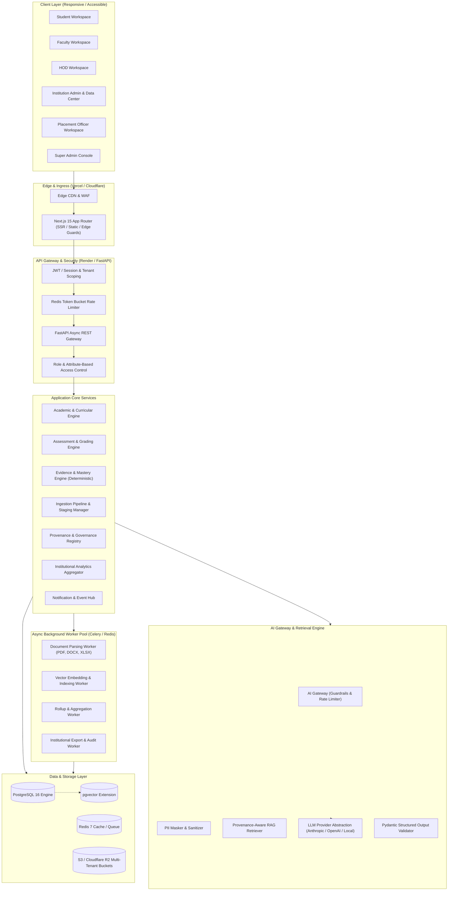
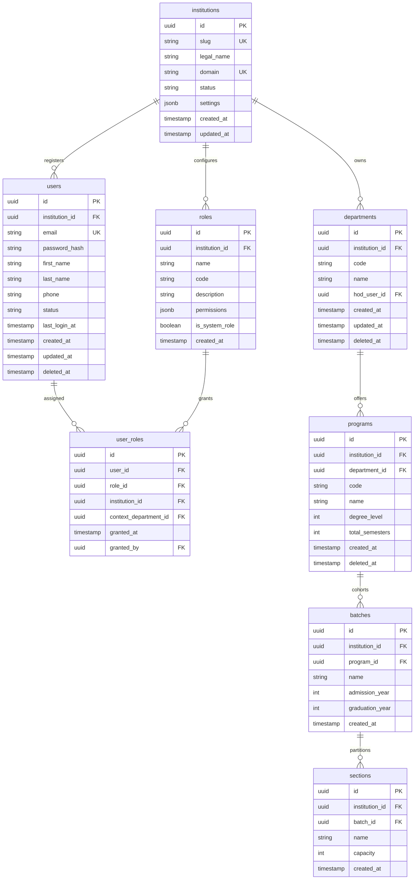
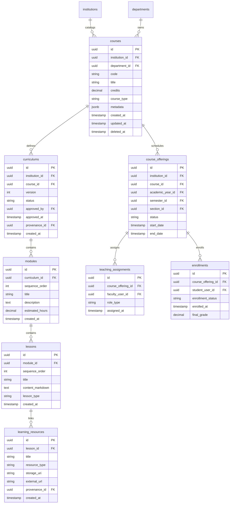
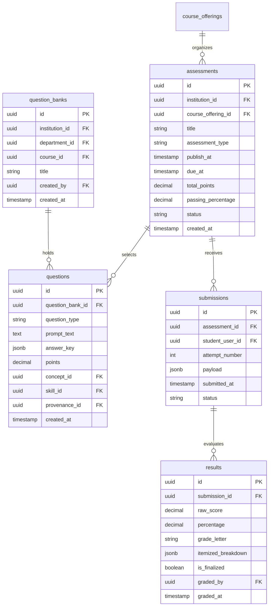
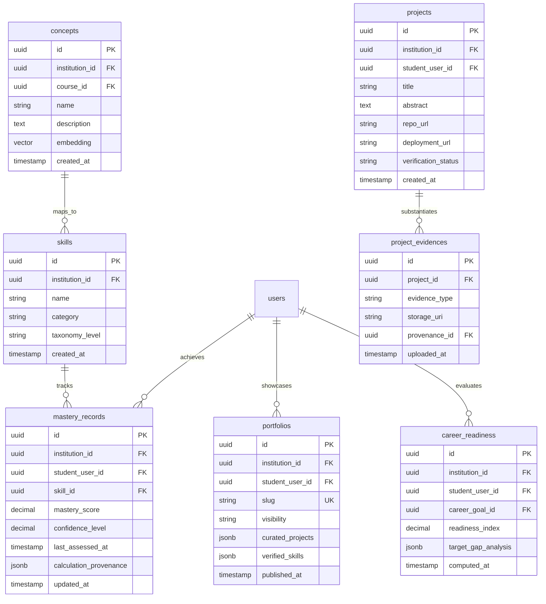
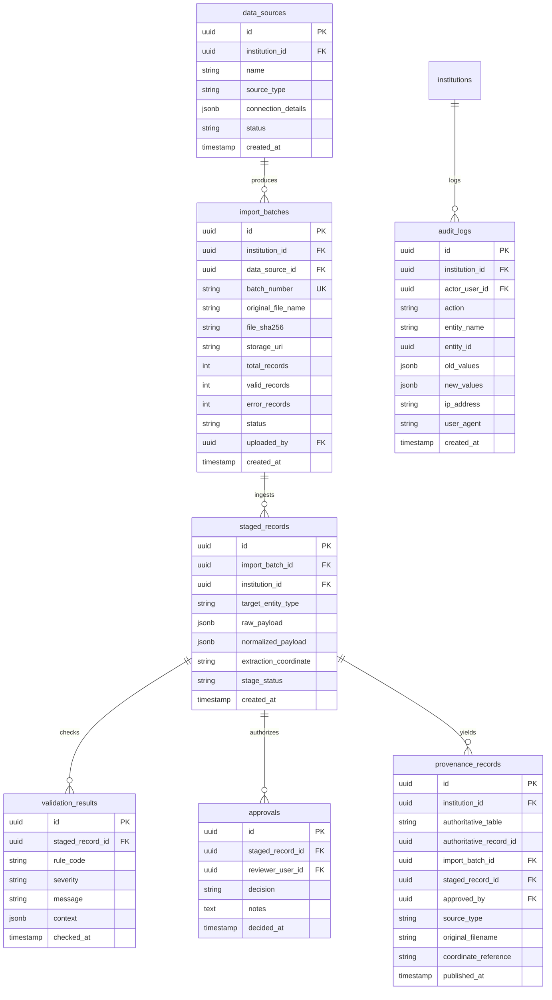

# DHRUVA.AI (V2) — MASTER TECHNICAL & PRODUCT ARCHITECTURE

> **Document Status:** Approved Architecture Blueprint  
> **Classification:** Engineering & Institutional Architecture  
> **Core Principle:** `NO SOURCE → NO DATA` (Zero Hallucination / Zero Synthetic Institutional Truth)  
> **Platform Version:** 2.0.0-PROD-BLUEPRINT  

---

## 1. Architecture Overview & Core Principles

Dhruva.AI is a secure, multi-tenant institutional intelligence and learning operating system. It bridges academic structures, active coursework, assessments, empirical learning evidence, verifiable skill mastery, student project portfolios, career readiness pathways, and executive institutional analytics.

### 1.1 The Permanent Product Rule: "NO SOURCE → NO DATA"
Institutional credibility is binary: once an educational platform fabricates, assumes, or hallucinates an academic record, institutional accreditation, transcript integrity, and operational trust collapse.
1. **Zero Synthetic Truth**: The system shall never synthesize academic records, official grades, attendance, curriculum requirements, or institutional metrics out of thin air.
2. **Explicit Provenance**: Every authoritative institutional record must track its genesis: the precise import batch, raw source document (file hash, page/sheet coordinate), submitting user, validation status, and authorized approver.
3. **AI as Assistant, Not Authority**: Large Language Models (LLMs) operate strictly as semantic processors, summarizers, personal tutors, and extraction draft generators. Deterministic calculations (GPA, mastery scores, attendance rates, compliance metrics, approval gates) are executed exclusively by deterministic code engines.
4. **Honest Failure States**: If an upstream service or AI inference engine fails, the system renders a transparent failure state. It never falls back to placeholder or synthetic mock data to appear functional.

---

## 2. High-Level System Architecture



---

## 3. Database Architecture & Complete ERD Proposal

The data tier is engineered on **PostgreSQL 16** with the **pgvector** extension. All institutional data is segregated by a mandatory `institution_id` discriminator with PostgreSQL **Row-Level Security (RLS)** active on all tenant-specific tables.

### 3.1 Tenancy & Identity Domain



### 3.2 Academic, Course & Learning Domain



### 3.3 Assessment, Submission & Deterministic Grading Domain



### 3.4 Mastery, Skills, Projects, Portfolio & Placement Domain



### 3.5 Provenance, Ingestion, Approval & Audit Domain



---

## 4. Domain Boundaries & Clean Architecture Structure

The codebase adheres strictly to Hexagonal / Clean Architecture with domain-driven segregation:

```
src/
├── domain/                      # Pure Business Rules & Entities (Zero Framework Dependencies)
│   ├── academic/                # Curriculums, Courses, Programs, Syllabi
│   ├── assessment/              # Grading Engines, Question Logic, Submissions
│   ├── mastery/                 # Deterministic Mastery, Skill Mapping
│   ├── ingestion/               # Parsers, Normalizers, Verification Rules
│   ├── provenance/              # Source Tracking, Audit Trails, Provenance Chains
│   └── identity/                # Tenants, Users, Roles, Policies
├── application/                 # Use Cases, Command/Query Handlers (CQS)
│   ├── academic/
│   ├── ingestion/
│   ├── assessment/
│   └── ai/                      # AI Orchestration, Prompt Context Assembly
├── infrastructure/              # Frameworks, DBs, Drivers, External APIs
│   ├── persistence/
│   │   ├── postgres/            # SQLAlchemy 2.0 Async Models, RLS, Repositories
│   │   └── migrations/          # Alembic Migrations
│   ├── storage/                 # S3 / Cloudflare R2 Client with Pre-signed URLs
│   ├── queue/                   # Celery / Redis Worker Client
│   ├── ai/                      # Anthropic / OpenAI / pgvector Integration
│   └── security/                # JWT, Argon2id, RBAC Guards, PII Maskers
└── interfaces/                  # Entry points into the system
    ├── http/                    # FastAPI Routes, Pydantic Schemas, Middlewares
    └── workers/                 # Celery Task Handlers (Ingestion, Rollups)
```

---

## 5. Backend Architecture Specification

- **Runtime & Framework**: Python 3.12+ with FastAPI (Async natively, high concurrency, strict type checking).
- **ORM & Data Layer**: SQLAlchemy 2.0 in async mode + Asyncpg driver.
- **Data Validation & Serialization**: Pydantic v2 (Rust-backed validation for ingestion pipelines).
- **Database Migrations**: Alembic with strict verification that all tables declare `institution_id` indexes and foreign key delete cascades.
- **Queue & Async Tasks**: Celery with Redis broker for compute-heavy ingestion parsing, embedding generation, and rollups.

---

## 6. Frontend Architecture Specification

- **Framework**: Next.js 15 (App Router, Server Components where advantageous, Client Components for interactive workflows).
- **Language**: TypeScript 5.5+ in strict mode.
- **State Management**: TanStack Query (React Query v5) for server state, server-side caching, optimistic updates, and offline resilience. Zustand for lightweight global UI states (dialogs, active filters, command palettes).
- **Component Primitives**: Radix UI headless accessible primitives paired with custom CSS design tokens (styled with standard Vanilla CSS / modern CSS variables).
- **UX Inspiration**: Linear (speed, keyboard shortcuts, dense information design) + Notion (clean layout, progressive disclosure) + modern institutional analytics.
- **Component States Policy**: Every single view and component must strictly implement 6 states:
  1. `LOADING`: Skeleton screens tailored to exact data geometry (no generic spinners).
  2. `SUCCESS`: Crisp, high-contrast, data-dense view.
  3. `EMPTY`: Explanatory message indicating what source data is required to populate this screen with direct link to the Data Center.
  4. `ERROR`: Diagnostic message with an error trace ID, retry action, and no data leaks.
  5. `NO_PERMISSION`: Clear message specifying the missing role or scope and an escalation path.
  6. `NO_RESULTS`: Specific message when filters yield 0 records, with a 1-click "Clear filters" action.

---

## 7. API Architecture & Standards

- **Protocol**: RESTful JSON over HTTPS / HTTP/2.
- **URL Conventions**:
  - Global Admin: `/api/v1/platform/...`
  - Tenant Scoped: `/api/v1/institutions/{institution_slug}/...`
- **Standard Envelope**:
```json
{
  "success": true,
  "data": {},
  "meta": {
    "requestId": "req_01J9X1234567890",
    "timestamp": "2026-10-07T12:00:00Z",
    "pagination": {
      "page": 1,
      "pageSize": 50,
      "totalRecords": 1250,
      "totalPages": 25
    }
  }
}
```
- **Standard Error Envelope**:
```json
{
  "success": false,
  "error": {
    "code": "INGESTION_VALIDATION_FAILED",
    "message": "Student roll number format invalid for batch 2026-CS",
    "details": [
      {
        "field": "roll_number",
        "row": 42,
        "issue": "Pattern mismatch: Expected format CS-YYYY-XXX"
      }
    ],
    "requestId": "req_01J9X1234567890"
  }
}
```

---

## 8. Authentication & RBAC Architecture

### 8.1 Authentication
- **Mechanism**: Dual-token system with short-lived access JWTs (15 minutes) and rotating, revocable refresh tokens (7 days) stored as `HttpOnly`, `SameSite=Strict`, `Secure` cookies.
- **Password Security**: Argon2id hashing algorithm with standard OWASP memory and iteration parameters.
- **Session Revocation**: Stored in Redis with tenant and user invalidation channels (instant logout across devices).

### 8.2 Role-Based Access Control (RBAC) Matrix

| Domain / Resource | Super Admin | Institution Admin | HOD | Faculty | Student | Placement Officer |
| :--- | :---: | :---: | :---: | :---: | :---: | :---: |
| **Multi-Tenant System Health** | Full | None | None | None | None | None |
| **Institution Settings & Roles** | Full | Full | View | None | None | None |
| **Data Center & Ingestion** | Full | Full | Read/Stage | None | None | None |
| **Approvals & Publishing** | Full | Full | Dept Only | None | None | None |
| **Curriculum & Courses** | Read | Full | Dept Edit | Read/Suggest | Read | Read |
| **Question Bank & Assessments** | None | Full | Dept Review | Full (Course) | Take/Submit | Read (Skills) |
| **Deterministic Grading** | None | Audit | Dept Audit | Full (Course) | View Own | None |
| **Student Mastery & Evidence** | None | Read | Dept Read | Course Edit | View Own | Read All |
| **Projects & Portfolios** | None | Read | Dept Read | Review/Verify | Create/Edit | Read All |
| **Placement Readiness** | None | Read | Dept Read | None | View Own | Full |
| **Audit Logs** | Global | Tenant Full | Dept Log | None | None | None |

---

## 9. Multi-Tenant Isolation Architecture

Tenant leakage is treated as a Category 0 architectural failure.

1. **Database Row-Level Security (RLS)**:
   - Every institutional table includes `institution_id UUID NOT NULL REFERENCES institutions(id)`.
   - Postgres session variable `app.current_institution_id` is set at the start of every connection check-out from the pool:
     ```sql
     SET LOCAL app.current_institution_id = 'tenant-uuid';
     ```
   - RLS policy:
     ```sql
     CREATE POLICY tenant_isolation_policy ON <table>
     AS RESTRICTIVE
     USING (institution_id = current_setting('app.current_institution_id')::uuid);
     ```
2. **Object Storage Segregation**:
   - Files are stored in tenant-isolated paths: `s3://bucket/tenants/{institution_id}/{category}/{year}/{hash}.ext`.
   - Pre-signed URLs are signed with strict 5-minute expirations and tenant-matching validation.
3. **Cache & Queue Isolation**:
   - Redis keys are prefixed: `tenant:{institution_id}:session:{user_id}`, `tenant:{institution_id}:cache:{key}`.
   - Background tasks validate the tenant context before initiating work.
4. **Vector Search Isolation**:
   - pgvector queries explicitly include an `institution_id = :tenant_id` filter prior to cosine/HNSW similarity evaluation.

---

## 10. Data Ingestion Architecture & Lifecycle

Authoritative institutional data follows an immutable 9-stage pipeline:

```
[1. UPLOAD]      --> Multipart upload of raw PDF/DOCX/XLSX/CSV to secure S3 quarantine.
[2. EXTRACT]     --> Background worker parses content using format-specific extractors.
[3. NORMALIZE]   --> Converts raw tabular or textual fields into standard Canonical DTOs.
[4. VALIDATE]    --> Deterministic validation rules execute (uniqueness, foreign keys, formatting).
[5. STAGE]       --> Records written to `staged_records` table with validation issues logged.
[6. REVIEW]      --> Authorized human reviewers inspect staged records in the Data Center.
[7. APPROVE]     --> Authorized HOD or Admin grants explicit digital approval.
[8. PUBLISH]     --> Transaction copies staged records into live authoritative tables.
[9. AUDIT]       --> Generates immutable provenance records and audit entries.
```

No AI or external parser directly writes to live tables. **Human approval is mandatory** for all newly staged data batches.

---

## 11. Provenance Architecture

To answer "Where did this data come from?" for every piece of institutional information, the system maintains a unified `provenance_records` table.

```
Authoritative Record (e.g. Course Syllabus or Student Grade)
   │
   └── points to ──> Provenance Record
                        ├── Source Type: [UPLOAD_SPREADSHEET | UPLOAD_PDF | MANUAL_ENTRY | SIS_SYNC]
                        ├── Source File: "2026_CS_Curriculum_Final.pdf" (SHA-256 Checksum)
                        ├── Batch ID: "BATCH-2026-10-0042"
                        ├── Extraction Coordinate: "Page 14, Section 3.2, Paragraph 1"
                        ├── Ingested By: User UUID (Registrar / Admin)
                        ├── Reviewed & Approved By: User UUID (HOD)
                        ├── Staged Timestamp & Approved Timestamp
                        └── Exact Raw Payload Snapshot at Ingestion
```

---

## 12. Approval & Governance Architecture

1. **Approval State Machine**:
   - `DRAFT` → `VALIDATED` → `REQUIRES_REVIEW` → `APPROVED` → `PUBLISHED` (or `REJECTED`).
2. **Granular Approval Scopes**:
   - Institution Admins approve institutional structure, batch enrollments, and global policies.
   - HODs approve department curriculum, syllabus modifications, and faculty teaching assignments.
   - Faculty submit question banks and assignment grades, which require HOD verification for final semester records.
3. **Zero Orphaned Edits**: Any change to an approved record creates a new version in `DRAFT` without modifying the live record until re-approved.

---

## 13. AI Architecture & Grounding Guardrails

```mermaid
flowchart LR
    UserInput["User Prompt / Query"] --> Guardrails["Prompt Injection Guard & PII Masker"]
    Guardrails --> TenantContext["Tenant-Scoped Context Builder"]
    TenantContext --> VectorStore["pgvector Retrival (Tenant Filtered)"]
    VectorStore --> ContextPacker["Provenance-Annotated Context"]
    ContextPacker --> ModelGateway["LLM Gateway (Anthropic / OpenAI)"]
    ModelGateway --> SchemaValidator["Pydantic Structured Schema Validation"]
    SchemaValidator --> OutputSanitizer["Output Sanitizer & Citation Verifier"]
    OutputSanitizer --> UserResponse["Verified Response with Citations"]
```



### 13.1 AI Rules & Guardrails
1. **Source Grounding**: AI outputs citing institutional facts must provide explicit citations to documents existing in `provenance_records`.
2. **Deterministic Fallbacks**: Calculations (grades, GPA, attendance, percentiles) are evaluated by code formulas; the LLM is only given the final calculated numbers to explain or summarize.
3. **Prompt Injection Defense**: All user inputs undergo delimiter wrapping, system prompt boundary enforcement, and token-level safety checks.
4. **PII Masking**: Student names, phone numbers, and addresses are redacted with surrogate identifiers (`[STUDENT_001]`) before dispatch to external LLMs.

---

## 14. Analytics Architecture

1. **Deterministic Rollup Pipeline**:
   - Nightly and event-driven rollups aggregate student progress, course pass rates, mastery distribution, and placement readiness into pre-computed aggregation tables.
   - Zero real-time ad-hoc heavy aggregation queries on transactional OLTP tables.
2. **Departmental Health Metrics**:
   - Curriculum completion rate vs. academic calendar timeline.
   - Assessment participation and difficulty distribution.
   - Early warning intervention flags (students with consecutive failing scores or low mastery indicators).
3. **Placement & Career Readiness Analytics**:
   - Skill coverage percentage against verified job market profiles.
   - Project verification rate (number of codebases or capstones validated by faculty).

---

## 15. Storage Architecture

- **Primary Object Storage**: S3-compatible storage (AWS S3 or Cloudflare R2).
- **Directory Hierarchy**:
  ```
  s3://dhruva-storage/
  └── tenants/{institution_id}/
      ├── quarantine/               # Incoming uploads awaiting antivirus & MIME check
      ├── documents/original/       # Raw uploaded spreadsheets, PDFs, syllabi
      ├── documents/parsed/         # Extracted normalized chunks
      ├── learning-resources/       # Course lecture notes, slides, readings
      └── student-evidence/         # Project artifacts, capstone write-ups, certificates
  ```
- **Security**: Direct public access is blocked. Files are retrieved through short-lived presigned URLs generated after verifying tenant ownership and user RBAC permissions.
- **Upload Validation**: File uploads enforce strict MIME type validation, file header magic-byte verification, and maximum size limits (e.g., 50MB for documents, 250MB for student archives).

---

## 16. Background Jobs Architecture

- **Engine**: Celery / ARQ backed by Redis.
- **Worker Queues**:
  1. `high-priority`: Real-time notifications, transactional security emails, immediate single-record validation.
  2. `ingestion`: Multi-page PDF OCR, large spreadsheet extraction (10,000+ rows), normalization workers.
  3. `embeddings`: pgvector embedding generation via batch AI embeddings.
  4. `analytics-rollups`: Hourly/daily aggregations and historical trend indexing.
- **Idempotency & Retries**: Every task carries a unique `job_id` and idempotent state transitions. Exponential backoff with dead-letter queue (DLQ) logging ensures zero silent failures.

---

## 17. Notification Architecture

- **Channels**: In-app real-time alerts (WebSockets / SSE), scheduled email digests, urgent institutional notices.
- **Event-Driven**:
  - `ASSESSMENT_PUBLISHED`
  - `SUBMISSION_GRADED`
  - `DATA_IMPORT_COMPLETED`
  - `APPROVAL_REQUIRED`
  - `INTERVENTION_FLAGGED`
- **Preferences**: Users can configure alert channels and quiet hours; system-critical security and compliance notices cannot be muted.

---

## 18. Search Architecture

- **Full-Text Search**: PostgreSQL `tsvector` with GiST/GIN indexing for fast lexical search over courses, student rosters, questions, and institutional documents.
- **Semantic / Vector Search**: `pgvector` utilizing HNSW indexing for concept-based question retrieval, curriculum alignment, and student project-skill matching.
- **Strict Scope**: Every search query must include the mandatory `institution_id` filter before executing vector distance calculations or full-text scoring.

---

## 19. Security Architecture

1. **Input Validation**: Strict schema enforcement at the perimeter using Pydantic v2.
2. **Output Sanitization**: Automated HTML escaping, Markdown sanitization via DOMPurify to neutralize Stored XSS.
3. **IDOR Defense**: All entity access verifies that `entity.institution_id == request.tenant_id` and that the user's role has permission for that specific entity.
4. **CORS & Headers**: Strict Content Security Policy (CSP), `X-Content-Type-Options: nosniff`, `X-Frame-Options: DENY`, `Strict-Transport-Security`.
5. **Rate Limiting**: Tiered IP and user rate limiting in Redis (e.g., 100 req/min for standard queries, 5 req/min for authentication and AI endpoints).

---

## 20. Testing Strategy

```
                  ┌──────────────────────┐
                  │    E2E Tests (5%)    │  Playwright (Complete User Workflows)
                  ├──────────────────────┤
                  │ Integration (20%)    │  API Endpoints + RLS + Ingestion Pipelines
                  ├──────────────────────┤
                  │ Unit Tests (75%)     │  Domain Logic, Parsers, Deterministic Math
                  └──────────────────────┘
```

- **Tenancy Tests**: Automated tests attempt cross-tenant reads and writes for every newly created endpoint; any data breach causes CI/CD pipeline failure.
- **Ingestion Golden Tests**: Deterministic test suites run sample CSV, XLSX, and PDF files to ensure normalized output matches expected schemas exactly.
- **AI Regression Tests**: Golden prompt evaluations with strict schema validation assertions to detect hallucinations or regression.

---

## 21. Deployment Architecture

- **Frontend**: Vercel (Next.js 15 Edge and Serverless rendering, global CDN asset caching).
- **Backend API**: Render (Docker container running FastAPI with Uvicorn workers).
- **Background Workers**: Render Background Worker services running Celery.
- **Database**: Managed PostgreSQL 16 (Render / Neon / AWS RDS) with `pgvector` extension.
- **Cache / Message Broker**: Upstash Redis or Render Managed Redis.
- **Zero Railway Dependency**: All deployment manifests use standard Docker and vendor-neutral configuration files.

---

## 22. Backup & Disaster Recovery Strategy

- **Recovery Point Objective (RPO)**: < 15 minutes (continuous WAL archiving and automated point-in-time recovery).
- **Recovery Time Objective (RTO)**: < 1 hour (automated database failover and containerized blue-green deployments).
- **Automated Verification**: Weekly restore rehearsals into an isolated testing environment to verify backup integrity and migration readiness.

---

## 23. Accessibility Strategy (WCAG 2.1 AA)

- **Semantic Markup**: Standard semantic HTML5 (`<main>`, `<nav>`, `<article>`, `<header>`, `<table>`) with zero generic `<div>` buttons.
- **Focus States**: High-contrast, visible focus rings on all interactive elements.
- **Keyboard Navigation**: Complete platform operational without a mouse (tab orders, Escape to close modals, Arrow keys for dropdowns and command palettes).
- **Color Contrast**: 4.5:1 minimum contrast ratio for normal text; 3:1 for large text and UI components.
- **Reduced Motion**: Respects `prefers-reduced-motion` media queries by disabling non-essential transitions.

---

## 24. Performance Strategy

- **Database Optimization**: Strict composite indexing: `(institution_id, created_at DESC)`, `(institution_id, status)`, foreign key indexes on all relationships.
- **API Response Target**: p95 < 120ms for cached queries, p95 < 250ms for complex filtered lists.
- **Virtualization**: Large tables (student rosters, staged records, audit logs) employ windowing/virtualization (TanStack Virtual) to maintain 60 FPS scrolling.
- **Asset Optimization**: Modern next-gen image formats (AVIF/WebP), tree-shaking, and lazy loading for non-critical route chunks.

---

## 25. UI/UX Design System Specification

- **Aesthetic Direction**: High-efficiency productivity tool (inspired by Linear and Notion). Minimal noise, tight typography, crisp borders, dark/light theme support.
- **Color Palette (Tokens)**:
  - Base: High-contrast neutral slates (`#090A0F`, `#12141A`, `#1E222D`, `#F8FAFC`).
  - Brand Accent: Deep institutional indigo (`#4F46E5` / `#6366F1`).
  - Success: Crisp emerald (`#10B981`).
  - Warning: Amber (`#F59E0B`).
  - Danger: Crimson (`#EF4444`).
- **Typography**: Inter / Outfit for high legibility, JetBrains Mono for codes, student roll numbers, and technical identifiers.

---

## 26. Navigation Architecture

- **Global Shell**:
  - Top Bar: Breadcrumb trail, institutional switcher (for Super Admin), global command palette (`Ctrl+K`), notifications bell, user avatar menu.
  - Left Sidebar: Contextual navigation matching the active role workspace.
- **Role-Specific Navigation Tree**:
  - **Student**: Home, My Learning, Courses, Assessments, Knowledge & Mastery, Review, Projects, Skills, Portfolio, Career Readiness.
  - **Faculty**: Overview, My Courses, Course Content, Question Bank, Assessments & Grading, Students & Evidence, Interventions, Analytics.
  - **HOD**: Department Overview, Academic Programs, Curriculums, Faculty Assignments, Student Progress, Approvals Queue, Department Analytics.
  - **Institution Admin**: Overview, Academic Structure, Data Center (Ingestion/Staging/Approval), User Management, Academic Catalog, Audit Logs, Settings.
  - **Placement Officer**: Overview, Student Talent Pool, Skill Matrix, Career Readiness Index, Project Showcases, Institutional Placement Analytics.
  - **Super Admin**: Institutions Registry, Global Catalog, System Health & Metrics, Security & Governance, Audit Logs.

---

## 27. The Data Center Architecture

The Data Center is the heart of Dhruva.AI's institutional trust:

1. **Data Center Overview**: High-level telemetry displaying total records ingested, current data freshness, active import batches, and pending approval items.
2. **Import Documents**: Dedicated wizard for uploading syllabi, policy manuals, and project briefs (PDF, DOCX) with OCR extraction preview.
3. **Import Spreadsheets**: Bulk ingestion interface for student rosters, faculty assignments, course catalogs, and past grades (CSV, XLSX) with real-time column mapping and schema validation.
4. **Manual Entry**: Controlled form-based entry with immediate referential integrity validation.
5. **Review Queue**: Multi-attribute filtering of staged records with side-by-side comparisons of raw source coordinates and normalized data.
6. **Validation Engine**: Detailed diagnostics showing failed rows, formatting violations, and missing prerequisites.
7. **Import History & Audit**: Immutable log of every file ever uploaded, including original file hashes, timestamps, uploaders, and approval records.

---

## 28. Role-Specific User Journeys

1. **Institution Onboarding (Admin)**: Create institution profile → Upload academic structure spreadsheet → Map columns → Review staged departments, programs, and batches → Grant digital approval → Records published to live catalog.
2. **Curriculum Design & Approval (Faculty & HOD)**: Faculty drafts course modules and learning objectives → Attaches source syllabus PDF → Ingestion extracts concepts → Faculty submits for departmental review → HOD reviews against curriculum standards → Approves → Curriculum published with provenance.
3. **Assessment & Deterministic Mastery (Faculty & Student)**: Faculty generates assessment from approved Question Bank → Student submits answers → Deterministic engine grades submission → Mastery record updates student skill confidence → Student reviews results with clear citation to learning resources.
4. **Placement Readiness & Verification (Student & Placement Officer)**: Student completes verified capstone project → Faculty signs off on project evidence → Placement Officer searches student pool by verified skills → Generates verified talent portfolio for recruitment partners.

---

## 29. Implementation Phases & Architecture Dependencies

```
[Phase 1: Foundation & Identity]
   └── Core DB, Tenancy RLS, Auth, RBAC, Base UI Design System
         │
[Phase 2: Academic Core & Catalog]
   └── Institutional Hierarchy, Programs, Courses, Offerings, Rosters
         │
[Phase 3: Data Center & Ingestion Pipeline]
   └── Parsers (CSV/XLSX/PDF), Staging Engine, Review Queue, Approvals, Provenance
         │
[Phase 4: Learning, Curriculum & Content]
   └── Modules, Lessons, Resources, Question Bank, Assessments, Deterministic Grading
         │
[Phase 5: Mastery, Evidence, Projects & Placement]
   └── Deterministic Mastery Engine, Project Verification, Portfolios, Career Readiness
         │
[Phase 6: Grounded AI Assistant & Analytics]
   └── Guardrailed AI Gateway, Provenance-Aware RAG, Institutional Analytics
         │
[Phase 7: Production Hardening, Audit & Deployment]
   └── Security Audits, E2E Testing, Accessibility Certification, Vercel/Render Deploy
```

---

## 30. Architectural Risks & Mitigations

| Identified Risk | Severity | Mitigation Strategy |
| :--- | :---: | :--- |
| **Cross-Tenant Data Leakage** | Critical | Enforce Postgres Row-Level Security (RLS) on all tables + Automated CI tests verifying cross-tenant queries fail with 0 records. |
| **AI Hallucinating Academic Records** | Critical | Strict architectural separation: LLMs have zero write access to authoritative tables; all grades and metrics use deterministic code engines. |
| **Corrupt / Malformed Bulk Uploads** | High | 9-stage ingestion pipeline with staging tables; zero unapproved data enters live tables; comprehensive rollback per batch. |
| **Performance Degradation with Large Batches** | Medium | Asynchronous worker processing via Celery + Redis; virtualized UI tables; paginated chunked imports. |
| **Stale Provenance Trails** | Medium | Database foreign key constraints binding every published record to an immutable `provenance_records` row. |
