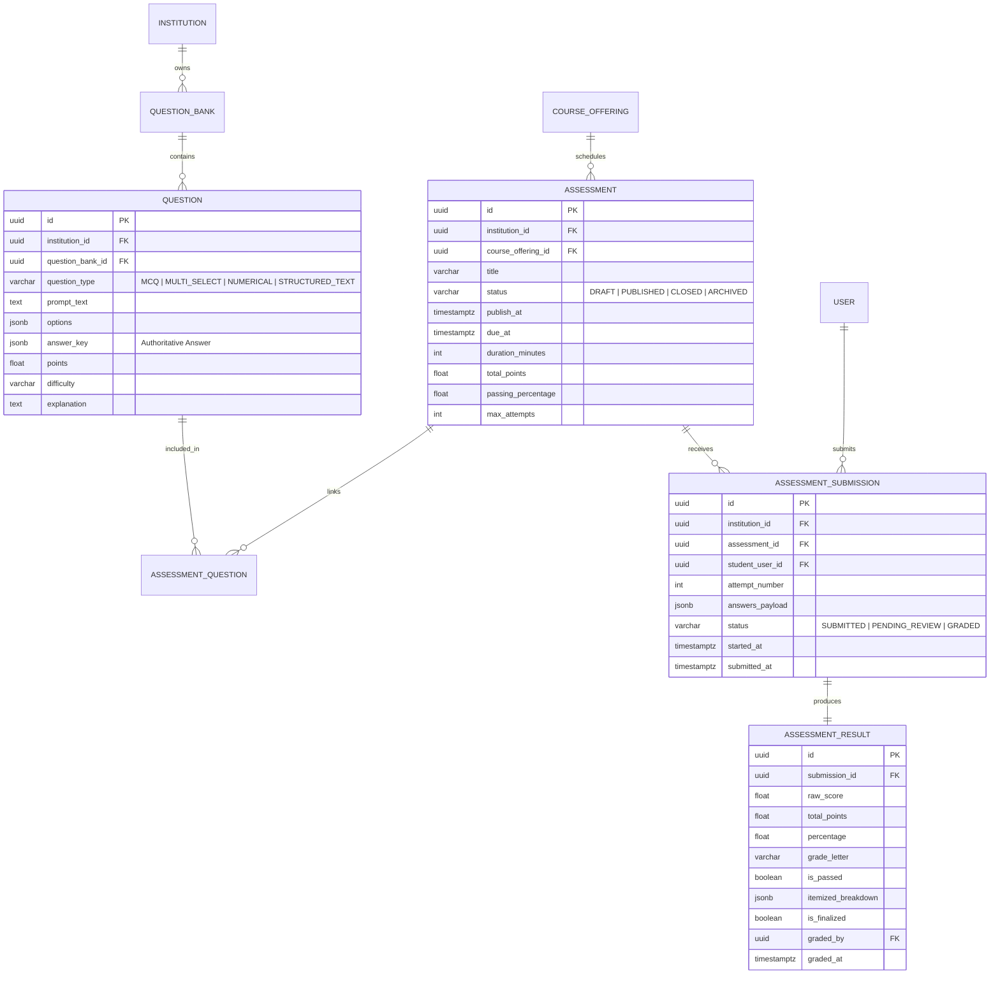
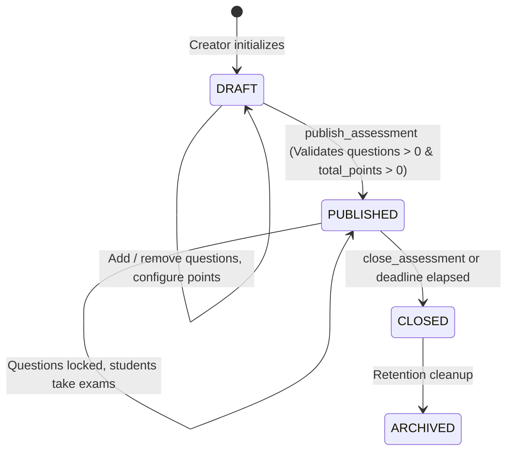
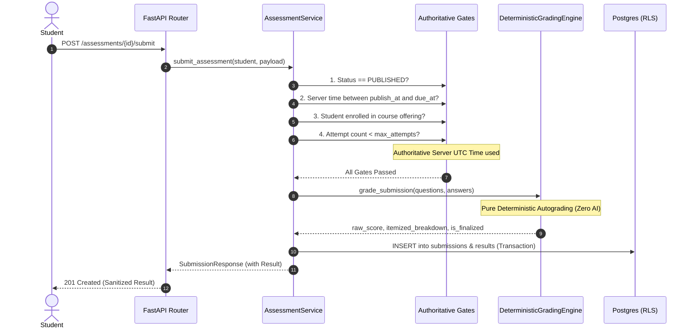

# DHRUVA.AI (V2) — ASSESSMENT, QUESTION BANK & DETERMINISTIC GRADING ENGINE

> **Status:** Production-Ready & Formally Tested  
> **Phase:** Assessment Domain & Grading Engine  
> **Alembic Migration:** `0005_assessment_question_bank_grading`  
> **Test Coverage:** 11/11 Domain & Grading Engine Tests Passed; 63/63 Total Backend Regression Tests Passed; 14/14 Frontend Tests Passed.  

---

## 1. Domain Entities & Database Schema

The Assessment domain models rigorous academic evaluations with multi-tenant data segregation, foreign key integrity, and zero answer-key leakage.



### Table Specifications & Constraints
1. **`question_banks`**:
   - `id` (UUID PK), `institution_id` (UUID FK), `course_id` (UUID FK NULL), `department_id` (UUID FK NULL), `title` (VARCHAR 255), `description` (TEXT), `created_by` (UUID FK).
   - RLS Policy: `tenant_isolation_question_banks` via `app.current_institution_id`.
2. **`questions`**:
   - `id` (UUID PK), `institution_id` (UUID FK), `question_bank_id` (UUID FK), `question_type` (VARCHAR 32), `prompt_text` (TEXT), `options` (JSONB), `answer_key` (JSONB), `points` (FLOAT, > 0), `difficulty` (VARCHAR 32), `explanation` (TEXT).
   - Index: `(institution_id, question_bank_id)`.
3. **`assessments`**:
   - `id` (UUID PK), `institution_id` (UUID FK), `course_offering_id` (UUID FK), `title` (VARCHAR 255), `instructions` (TEXT), `assessment_type` (VARCHAR 32), `status` (VARCHAR 32, Default: `DRAFT`), `publish_at` (TIMESTAMPTZ), `due_at` (TIMESTAMPTZ), `duration_minutes` (INT NULL), `total_points` (FLOAT, Default: 0.0), `passing_percentage` (FLOAT, Default: 40.0), `max_attempts` (INT, Default: 1).
   - Constraints: `due_at > publish_at`, `max_attempts >= 1`.
4. **`assessment_questions`**:
   - `id` (UUID PK), `assessment_id` (UUID FK), `question_id` (UUID FK), `points` (FLOAT), `sort_order` (INT).
   - Unique Constraint: `(assessment_id, question_id)` (prevents duplicate question inclusions).
5. **`submissions`**:
   - `id` (UUID PK), `institution_id` (UUID FK), `assessment_id` (UUID FK), `student_user_id` (UUID FK), `attempt_number` (INT), `answers_payload` (JSONB), `status` (VARCHAR 32), `started_at` (TIMESTAMPTZ), `submitted_at` (TIMESTAMPTZ).
   - Unique Constraint: `(assessment_id, student_user_id, attempt_number)` (prevents race-condition duplicate attempt records).
6. **`results`**:
   - `id` (UUID PK), `institution_id` (UUID FK), `submission_id` (UUID FK UNIQUE), `raw_score` (FLOAT), `total_points` (FLOAT), `percentage` (FLOAT), `grade_letter` (VARCHAR 8), `is_passed` (BOOLEAN), `itemized_breakdown` (JSONB), `is_finalized` (BOOLEAN), `graded_by` (UUID FK NULL), `graded_at` (TIMESTAMPTZ).

---

## 2. API Endpoints & Contracts

All endpoints are prefixed by `/api/v1/institutions/{institution_slug}`.

| Method | Endpoint | Authorized Roles | Description |
| :--- | :--- | :--- | :--- |
| `POST` | `/question-banks` | `SUPER_ADMIN`, `INSTITUTION_ADMIN`, `HOD`, `FACULTY` | Create question bank |
| `GET` | `/question-banks` | `SUPER_ADMIN`, `INSTITUTION_ADMIN`, `HOD`, `FACULTY` | List institutional question banks |
| `GET` | `/question-banks/{bank_id}` | `SUPER_ADMIN`, `INSTITUTION_ADMIN`, `HOD`, `FACULTY` | Get bank details |
| `POST` | `/question-banks/{bank_id}/questions` | `SUPER_ADMIN`, `INSTITUTION_ADMIN`, `HOD`, `FACULTY` | Author new validated question |
| `GET` | `/question-banks/{bank_id}/questions` | `SUPER_ADMIN`, `INSTITUTION_ADMIN`, `HOD`, `FACULTY` | List questions with full answer keys |
| `POST` | `/assessments` | `SUPER_ADMIN`, `INSTITUTION_ADMIN`, `HOD`, `FACULTY` | Create assessment (Draft) |
| `GET` | `/assessments` | All authenticated users | List assessments for offering/tenant |
| `GET` | `/assessments/{assessment_id}` | All authenticated users | Get assessment. **Role-Sensitive:** Students receive sanitized view without `answer_key` |
| `POST` | `/assessments/{assessment_id}/questions` | `SUPER_ADMIN`, `INSTITUTION_ADMIN`, `HOD`, `FACULTY` | Allocate question & marks (Draft only) |
| `POST` | `/assessments/{assessment_id}/publish` | `SUPER_ADMIN`, `INSTITUTION_ADMIN`, `HOD`, `FACULTY` | Publish assessment (locks questions) |
| `POST` | `/assessments/{assessment_id}/close` | `SUPER_ADMIN`, `INSTITUTION_ADMIN`, `HOD`, `FACULTY` | Close assessment |
| `POST` | `/assessments/{assessment_id}/submit` | Authenticated Enrolled Students | Submit attempt & invoke deterministic autograder |
| `GET` | `/submissions/{submission_id}` | Student (own) / Faculty & Admins | Get submission attempt and itemized score |
| `GET` | `/assessments/{assessment_id}/submissions` | Faculty & Admins | List all student submissions |
| `POST` | `/submissions/{submission_id}/grade-manual` | Faculty & Reviewers | Review subjective question and award marks |

---

## 3. Assessment & Submission Lifecycle

### Assessment State Machine

- **Rule 1:** Questions can only be added or modified in `DRAFT` status. Once `PUBLISHED`, questions are immutable to protect student exam integrity.
- **Rule 2:** An assessment cannot be published if it contains 0 questions or has a total score of 0.

### Submission Workflow & Timing Gates


---

## 4. Deterministic Grading Engine Specifications

Under **Non-Negotiable Rule 9**, artificial intelligence/LLMs are strictly forbidden from determining authoritative grades.

### Mathematical Scoring Rules
1. **Multiple Choice Question (`MCQ`)**:
   $$\text{Score} = \begin{cases} \text{Points}, & \text{if } \text{submitted} = \text{correct\_option\_id} \\ 0.0, & \text{otherwise} \end{cases}$$
2. **Multi-Select Question (`MULTI_SELECT`)**:
   Let $C$ be the set of correct option IDs, and $S$ be the student's selected options.
   $$\text{Score} = \begin{cases}
   0.0, & \text{if } S \setminus C \neq \emptyset \text{ (Anti-guessing penalty for selecting incorrect options)} \\
   \text{Points}, & \text{if } S = C \\
   \frac{|S|}{|C|} \times \text{Points}, & \text{if } S \subset C \land S \neq \emptyset \text{ (Proportional partial credit)} \\
   0.0, & \text{if } S = \emptyset
   \end{cases}$$
3. **Numerical Question (`NUMERICAL`)**:
   Let $V_t$ be the target value and $\tau$ be the configured tolerance.
   $$\text{Score} = \begin{cases} \text{Points}, & \text{if } |V_s - V_t| \le \tau + 10^{-9} \\ 0.0, & \text{otherwise} \end{cases}$$
4. **Structured Text (`STRUCTURED_TEXT`)**:
   - Initial Autograde Status: `PENDING_MANUAL`.
   - Initial Awarded Points: `0.0`.
   - Result Flag: `is_finalized = False`, Submission Status: `PENDING_REVIEW`.
   - Subjective response is queued for faculty manual evaluation.

### Institutional Grading Scale
$$\text{Percentage} = \text{round}\left(\frac{\text{Raw Score}}{\text{Total Possible Points}} \times 100.0, 2\right)$$

| Percentage Interval | Letter Grade | Passing Status ($\ge 40.0\%$) |
| :--- | :--- | :--- |
| $[90.0\%, 100.0\%]$ | `A+` | Passed |
| $[80.0\%, 90.0\%)$ | `A` | Passed |
| $[70.0\%, 80.0\%)$ | `B` | Passed |
| $[60.0\%, 70.0\%)$ | `C` | Passed |
| $[50.0\%, 60.0\%)$ | `D` | Passed |
| $[0.0\%, 50.0\%)$ | `F` | Failed if below threshold |

---

## 5. Security & Zero Answer-Key Leakage Protections

1. **Schema Segregation**:
   - `QuestionAdminResponse` includes `answer_key` and internal `explanation`.
   - `QuestionStudentResponse` contains only `id`, `prompt_text`, `options`, `points`, `difficulty`.
2. **Dynamic Endpoint Sanitization**:
   - In `GET /assessments/{assessment_id}`, the user's role is inspected. If the user possesses only the `STUDENT` role, the response is serialized using `AssessmentStudentDetailResponse`, stripping all answer keys and evaluation rubrics.
3. **Cross-Tenant Row-Level Security**:
   - Migration `0005` implements PostgreSQL RLS policies on `question_banks`, `questions`, `assessments`, `assessment_questions`, `submissions`, and `results`, scoping every query to `institution_id = current_setting('app.current_institution_id')::uuid`.
4. **Student Submission Privacy**:
   - In `GET /submissions/{id}`, if the requesting user is a student, the service strictly checks `submission.student_user_id == current_user.id`. Any attempt to view another student's submission yields `403 PermissionDeniedError`.

---

## 6. Verification & Test Evidence

### Backend Test Execution
```bash
python -m pytest tests/test_assessment_engine.py -v
```
**Results:**
- `test_mcq_grading` PASSED
- `test_multi_select_grading` PASSED
- `test_numerical_grading` PASSED
- `test_structured_text_pending_manual` PASSED
- `test_letter_grade_calculation` PASSED
- `test_overall_submission_grading` PASSED
- `test_question_bank_and_question_validation` PASSED
- `test_assessment_lifecycle_and_zero_leakage` PASSED
- `test_end_to_end_submission_and_autograding` PASSED
- `test_enrollment_and_timing_gates` PASSED
- `test_cross_tenant_isolation` PASSED
**Total:** 11 passed in 3.93s.

### Full Backend Regression Test Suite
```bash
python -m pytest tests/ -v
```
**Results:**
- 63 passed across academic hierarchy, authentication, platform health, assessment engine, curriculum/content, data center ingestion, RBAC matrix, security hashing, and tenant isolation in 19.06s.

### Frontend Regression Suite
```bash
npm test
npm run typecheck
```
**Results:**
- 14 passed in 1020ms; TypeScript zero type errors.

---

## 7. Migration Instructions

To apply the Phase 4 database migration in PostgreSQL:
```bash
cd backend
alembic upgrade head
```
Migration identifier: `0005_assessment_question_bank_grading` (Down revision: `0004_data_center_ingestion_provenance`).
