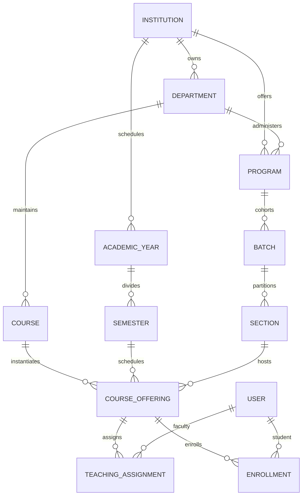

# Dhruva.AI V2 — Phase 2: Institution & Academic Structure Architecture

## 1. Domain Overview & Scope Boundaries
Phase 2 implements the hierarchical academic structure required to support multi-tenant universities and colleges on top of the verified Phase 1 foundation:
- **Academic Hierarchy**: Departments, Degree Programs, Batches/Cohorts, Sections.
- **Academic Calendar**: Academic Years, Semesters/Terms.
- **Curriculum Catalog**: Courses, Course Offerings.
- **Faculty & Student Relationships**: Faculty Profiles, Student Profiles, Teaching Assignments, Course Offerings Enrollments.
- **Isolated Management UI**: Academic hierarchy dashboard in Next.js workspace.

> **Explicit Boundaries**: LMS, lessons, assessments, grading engines, student mastery, career intelligence, analytics dashboards, and AI integrations remain strictly excluded until subsequent phases.

---

## 2. Entity Relationships & Ownership Hierarchy

### Table Specifications & Constraints
1. **`departments`**:
   - `id` (UUID PK), `institution_id` (FK institutions, CASCADE), `code` (VARCHAR 32), `name` (VARCHAR 128), `hod_user_id` (FK users, SET NULL), `status` (ACTIVE/INACTIVE), `deleted_at` (TIMESTAMPTZ).
   - Constraints: `UNIQUE (institution_id, code)`.
2. **`programs`**:
   - `id` (UUID PK), `institution_id` (FK), `department_id` (FK departments, CASCADE), `code` (VARCHAR 32), `name` (VARCHAR 128), `degree_level` (UNDERGRADUATE/POSTGRADUATE/DIPLOMA/DOCTORAL), `total_semesters` (INT >= 1), `status` (ACTIVE).
   - Constraints: `UNIQUE (institution_id, code)`.
3. **`academic_years`**:
   - `id` (UUID PK), `institution_id` (FK), `code` (VARCHAR 32), `name` (VARCHAR 64), `start_date` (DATE), `end_date` (DATE), `is_current` (BOOLEAN).
   - Constraints: `UNIQUE (institution_id, code)`, Invariant: `start_date < end_date`.
4. **`semesters`**:
   - `id` (UUID PK), `institution_id` (FK), `academic_year_id` (FK academic_years, CASCADE), `term_number` (INT >= 1), `name` (VARCHAR 64), `start_date` (DATE), `end_date` (DATE), `status` (UPCOMING/ONGOING/COMPLETED/ARCHIVED).
   - Constraints: `UNIQUE (academic_year_id, term_number)`, Invariant: `ay.start_date <= start_date < end_date <= ay.end_date`.
5. **`batches`**:
   - `id` (UUID PK), `institution_id` (FK), `program_id` (FK programs, CASCADE), `name` (VARCHAR 64), `admission_year` (INT), `graduation_year` (INT).
   - Constraints: `UNIQUE (program_id, name)`, Invariant: `graduation_year >= admission_year`.
6. **`sections`**:
   - `id` (UUID PK), `institution_id` (FK), `batch_id` (FK batches, CASCADE), `name` (VARCHAR 32), `capacity` (INT >= 1).
   - Constraints: `UNIQUE (batch_id, name)`.
7. **`courses`**:
   - `id` (UUID PK), `institution_id` (FK), `department_id` (FK departments, CASCADE), `code` (VARCHAR 32), `title` (VARCHAR 255), `credits` (FLOAT >= 0), `course_type` (THEORY/LAB/SEMINAR/PROJECT/ELECTIVE), `course_metadata` (JSON), `deleted_at` (TIMESTAMPTZ).
   - Constraints: `UNIQUE (institution_id, code)`.
8. **`course_offerings`**:
   - `id` (UUID PK), `institution_id` (FK), `course_id` (FK courses, CASCADE), `academic_year_id` (FK), `semester_id` (FK semesters, CASCADE), `section_id` (FK sections, SET NULL), `status` (PLANNED/OPEN/RUNNING/COMPLETED/ARCHIVED), `start_date` (DATE), `end_date` (DATE).
9. **`teaching_assignments`**:
   - `id` (UUID PK), `course_offering_id` (FK course_offerings, CASCADE), `faculty_user_id` (FK users, CASCADE), `role_type` (PRIMARY_INSTRUCTOR/CO_INSTRUCTOR/TA), `assigned_at` (TIMESTAMPTZ).
   - Constraints: `UNIQUE (course_offering_id, faculty_user_id)`.
10. **`enrollments`**:
    - `id` (UUID PK), `institution_id` (FK), `course_offering_id` (FK course_offerings, CASCADE), `student_user_id` (FK users, CASCADE), `enrollment_status` (ENROLLED/DROPPED/COMPLETED), `enrolled_at` (TIMESTAMPTZ), `final_grade` (FLOAT).
    - Constraints: `UNIQUE (course_offering_id, student_user_id)`.
11. **`students`**:
    - `id` (UUID PK), `user_id` (FK users, CASCADE, UNIQUE), `institution_id` (FK), `department_id` (FK), `program_id` (FK), `batch_id` (FK), `section_id` (FK), `roll_number` (VARCHAR 64), `admission_date` (DATE), `academic_status` (ACTIVE).
    - Constraints: `UNIQUE (institution_id, roll_number)`.
12. **`faculty`**:
    - `id` (UUID PK), `user_id` (FK users, CASCADE, UNIQUE), `institution_id` (FK), `department_id` (FK), `employee_id` (VARCHAR 64), `designation` (VARCHAR 64), `status` (ACTIVE).
    - Constraints: `UNIQUE (institution_id, employee_id)`.

---

## 3. Tenant Ownership & Isolation Strategy

1. **Path-Based Routing & Context Resolution**:
   - All academic structure routes reside under `/api/v1/institutions/{institution_slug}/...`.
   - The `get_current_tenant` dependency verifies that the user belongs to the requested institution (or is a platform `SUPER_ADMIN`).
   - Requests targeting an unauthorized institution return `HTTP 403 Forbidden` (`TENANT_ACCESS_DENIED`).
2. **PostgreSQL Row-Level Security (RLS)**:
   - Migration `0002_academic_hierarchy.py` enables RLS across all 12 tables:
     - `departments`, `programs`, `academic_years`, `semesters`, `batches`, `sections`, `courses`, `course_offerings`, `teaching_assignments`, `enrollments`, `students`, `faculty`.
   - Enforces `tenant_isolation_policy` comparing `institution_id = NULLIF(current_setting('app.current_institution_id', true), '')::uuid`.
3. **Application & Service Layer Validation**:
   - `AcademicService` strictly validates that referenced entities (e.g. department when creating program, academic year when creating semester, course & semester when creating offering) belong to the caller's verified `institution_id`. Cross-tenant foreign key references are rejected immediately.
4. **Audit Logging**:
   - All academic structure mutations (`ACADEMIC_DEPARTMENT_CREATED`, `ACADEMIC_PROGRAM_CREATED`, `ACADEMIC_YEAR_CREATED`, `ACADEMIC_SEMESTER_CREATED`, `ACADEMIC_BATCH_CREATED`, `ACADEMIC_SECTION_CREATED`, `ACADEMIC_COURSE_CREATED`, `ACADEMIC_OFFERING_CREATED`, `ACADEMIC_FACULTY_ASSIGNED`, `ACADEMIC_STUDENT_ENROLLED`) are recorded in `audit_logs` with zero secret leakage.

---

## 4. API Endpoints & RBAC Matrix

| Endpoint | Method | Required Roles | Description |
|---|---|---|---|
| `/institutions/{slug}/departments` | GET | Any Authenticated Tenant User | List departments |
| `/institutions/{slug}/departments` | POST | SUPER_ADMIN, INSTITUTION_ADMIN | Create department |
| `/institutions/{slug}/departments/{id}` | GET | Any Authenticated Tenant User | Get department details |
| `/institutions/{slug}/programs` | GET | Any Authenticated Tenant User | List programs |
| `/institutions/{slug}/programs` | POST | SUPER_ADMIN, INSTITUTION_ADMIN, HOD | Create program |
| `/institutions/{slug}/programs/{id}` | GET | Any Authenticated Tenant User | Get program details |
| `/institutions/{slug}/academic-years` | GET | Any Authenticated Tenant User | List academic years |
| `/institutions/{slug}/academic-years` | POST | SUPER_ADMIN, INSTITUTION_ADMIN | Create academic year |
| `/institutions/{slug}/academic-years/{id}/semesters` | GET | Any Authenticated Tenant User | List semesters |
| `/institutions/{slug}/academic-years/{id}/semesters` | POST | SUPER_ADMIN, INSTITUTION_ADMIN | Create semester |
| `/institutions/{slug}/batches` | GET | Any Authenticated Tenant User | List cohort batches |
| `/institutions/{slug}/batches` | POST | SUPER_ADMIN, INSTITUTION_ADMIN, HOD | Create batch |
| `/institutions/{slug}/batches/{id}/sections` | GET | Any Authenticated Tenant User | List sections |
| `/institutions/{slug}/batches/{id}/sections` | POST | SUPER_ADMIN, INSTITUTION_ADMIN, HOD | Create section |
| `/institutions/{slug}/courses` | GET | Any Authenticated Tenant User | List courses |
| `/institutions/{slug}/courses` | POST | SUPER_ADMIN, INSTITUTION_ADMIN, HOD | Create course |
| `/institutions/{slug}/offerings` | GET | Any Authenticated Tenant User | List course offerings |
| `/institutions/{slug}/offerings` | POST | SUPER_ADMIN, INSTITUTION_ADMIN, HOD | Create course offering |
| `/institutions/{slug}/offerings/{id}/assign-faculty` | POST | SUPER_ADMIN, INSTITUTION_ADMIN, HOD | Assign faculty |
| `/institutions/{slug}/offerings/{id}/enroll` | POST | SUPER_ADMIN, INSTITUTION_ADMIN, HOD | Enroll student |
| `/institutions/{slug}/offerings/{id}/enrollments` | GET | SUPER_ADMIN, INSTITUTION_ADMIN, HOD, FACULTY | List enrollments |

---

## 5. UI Implementation & States

- **Route**: `/workspace/academic`
- **Tabs**:
  1. *Departments & Programs*: Tabular listing and registration modals for departments and degree programs.
  2. *Calendar & Terms*: Tabular listing and scheduling modal for academic calendar years and term bounds.
  3. *Batches & Cohorts*: Intake cohort management and section capacity views.
  4. *Course Catalog*: Master course catalog with credit allocations and course type categorizations.
- **State Handling**:
  - *Loading*: Informative progress state during data retrieval.
  - *Success*: High-density, accessible tabular data display using design system `Table` component.
  - *Empty State*: Context-specific `EmptyState` component with direct action prompts.
  - *Search/Filter*: Dynamic real-time search with zero-result empty state.
  - *Permission Gating*: Read-only badge and action button suppression for unauthorized roles (e.g. Students).
  - *Error State*: Retryable `ErrorState` presenting correlation request IDs and code descriptions.

---

## 6. Verification & Quality Gates

### Backend Test Results
- **Test Suite**: `python -m pytest tests -v`
- **Total Tests**: 39
- **Passed**: 39
- **Failed**: 0
- **Coverage**:
  - 33 Baseline Phase 1 tests (Authentication, Token handling, Argon2id passwords, RBAC permissions, Health endpoints, Tenant isolation).
  - 6 Phase 2 Academic tests:
    - Full hierarchy creation workflow (`test_complete_academic_hierarchy_creation`)
    - Unique code conflict rejection (`test_duplicate_code_conflicts_rejected`)
    - Calendar date order and bounds invariants (`test_academic_calendar_date_invariants`)
    - Double enrollment rejection (`test_duplicate_enrollment_rejected`)
    - Cross-tenant denial (`test_cross_tenant_academic_access_strictly_denied`)
    - Student privilege boundary restriction (`test_student_role_cannot_manage_academic_structure`)

### Migration Verification
- Alembic migrations applied sequentially on clean SQLite and PostgreSQL schemas:
  `alembic upgrade head` -> `0001_core_foundation` -> `0002_academic_hierarchy`.
- Zero errors, fully reversible.

### Frontend Verification
- `npm run typecheck`: 0 errors.
- `npm run build`: Production bundle optimized; all routes compiled as static content (`/workspace/academic` - 7.45 kB).

---

## 7. Known Limitations & Roadmap for Next Phase
- **Phase 3 Hand-off**: Phase 2 provides the relational backbone for LMS and curriculum design. Course offerings and enrollments will serve as the container for learning modules, assignments, submissions, and mastery tracking.
