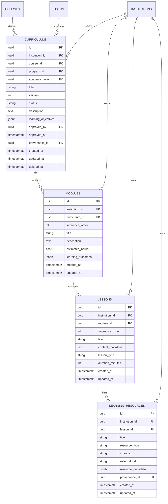

# Dhruva.AI V2 — Phase 3: Curriculum, Syllabus & Content Management Architecture

## 1. Domain Overview & Scope Boundaries
Phase 3 implements the curriculum, syllabus, and educational content management capabilities on top of the verified Phase 1 Foundation and Phase 2 Academic Hierarchy:
- **Curriculum Structure & Versioning**: Versioned curriculum specifications for accredited courses.
- **Syllabus & Instructional Units**: Multi-tiered hierarchy of Modules (units) and Lessons (topics).
- **Learning Objectives & Outcomes**: Course-level objectives, module-level outcomes, and lesson duration/types.
- **Learning Resource Content**: Document, slide, code, video, and reference metadata attached to individual lessons.
- **Publication Lifecycle & Approvals**: `DRAFT` -> `IN_REVIEW` -> `APPROVED` -> `PUBLISHED` -> `ARCHIVED` state machine.
- **Curriculum Management UI**: Interactive syllabus inspector and management workspace in Next.js.

> **Explicit Boundaries**: Assessments, question banks, grading, LMS student submissions, mastery models, career intelligence, and AI features remain strictly excluded until subsequent phases.

---

## 2. Entity Relationships & Domain Hierarchy

### Table Specifications & Constraints
1. **`curriculums`**:
   - `id` (UUID PK), `institution_id` (FK institutions, CASCADE), `course_id` (FK courses, CASCADE), `program_id` (FK programs, SET NULL), `academic_year_id` (FK academic_years, SET NULL).
   - `title` (VARCHAR 255), `version` (INT, default 1), `status` (VARCHAR 32, default DRAFT), `description` (TEXT), `learning_objectives` (JSON list).
   - `approved_by` (FK users, SET NULL), `approved_at` (TIMESTAMPTZ), `provenance_id` (UUID).
   - Constraints: `UNIQUE (course_id, version)`, Indexes on `(institution_id, course_id)`, `(institution_id, status)`.
2. **`modules`**:
   - `id` (UUID PK), `institution_id` (FK institutions, CASCADE), `curriculum_id` (FK curriculums, CASCADE).
   - `sequence_order` (INT >= 1), `title` (VARCHAR 255), `description` (TEXT), `estimated_hours` (FLOAT >= 0), `learning_outcomes` (JSON list).
   - Constraints: `UNIQUE (curriculum_id, sequence_order)`.
3. **`lessons`**:
   - `id` (UUID PK), `institution_id` (FK institutions, CASCADE), `module_id` (FK modules, CASCADE).
   - `sequence_order` (INT >= 1), `title` (VARCHAR 255), `content_markdown` (TEXT), `lesson_type` (VARCHAR 32, default THEORY), `duration_minutes` (INT >= 1).
   - Constraints: `UNIQUE (module_id, sequence_order)`.
4. **`learning_resources`**:
   - `id` (UUID PK), `institution_id` (FK institutions, CASCADE), `lesson_id` (FK lessons, CASCADE).
   - `title` (VARCHAR 255), `resource_type` (VARCHAR 32: DOCUMENT, SLIDE, CODE, VIDEO, EXTERNAL_LINK, REFERENCE).
   - `storage_uri` (VARCHAR 512), `external_url` (VARCHAR 512), `resource_metadata` (JSON), `provenance_id` (UUID).

---

## 3. Tenant Ownership & Isolation Strategy

1. **Path-Based Routing & Tenant Boundary Context**:
   - All curriculum and syllabus routes reside under `/api/v1/institutions/{institution_slug}/...`.
   - The `get_current_tenant` dependency resolves and validates institution boundaries, rejecting cross-tenant attempts with `HTTP 403 Forbidden` (`TENANT_ACCESS_DENIED`).
2. **PostgreSQL Row-Level Security (RLS)**:
   - Migration `0003_curriculum_syllabus_content.py` enables RLS across all 4 domain tables: `curriculums`, `modules`, `lessons`, `learning_resources`.
   - Evaluates `institution_id = NULLIF(current_setting('app.current_institution_id', true), '')::uuid`.
3. **Service-Layer Invariant Enforcement**:
   - `CurriculumService` ensures that parent course, program, academic year, curriculum, module, and lesson entities all belong to the caller's verified `institution_id`. Cross-tenant foreign keys are rejected immediately.
4. **Audit Logging**:
   - Actions recorded in `audit_logs`:
     - `CURRICULUM_VERSION_CREATED`
     - `CURRICULUM_STATUS_UPDATED`
     - `CURRICULUM_MODULE_CREATED`
     - `CURRICULUM_LESSON_CREATED`
     - `CURRICULUM_RESOURCE_ATTACHED`

---

## 4. API Endpoints & RBAC Matrix

| Endpoint | Method | Required Roles | Description |
|---|---|---|---|
| `/institutions/{slug}/courses/{id}/curriculums` | GET | Any Authenticated Tenant User | List curriculum versions for course |
| `/institutions/{slug}/courses/{id}/curriculums` | POST | SUPER_ADMIN, INSTITUTION_ADMIN, HOD, FACULTY | Create new curriculum version |
| `/institutions/{slug}/curriculums` | GET | Any Authenticated Tenant User | List all curriculums (optional status filter) |
| `/institutions/{slug}/curriculums/{id}` | GET | Any Authenticated Tenant User | Get curriculum with complete syllabus tree |
| `/institutions/{slug}/curriculums/{id}/status` | PATCH | Role-Gated: Faculty (Draft->Review), Admin/HOD (Approve, Publish, Archive) | Update publication lifecycle status |
| `/institutions/{slug}/curriculums/{id}/modules` | GET | Any Authenticated Tenant User | List instructional modules |
| `/institutions/{slug}/curriculums/{id}/modules` | POST | SUPER_ADMIN, INSTITUTION_ADMIN, HOD, FACULTY | Add module to curriculum |
| `/institutions/{slug}/modules/{id}/lessons` | GET | Any Authenticated Tenant User | List lessons / syllabus topics |
| `/institutions/{slug}/modules/{id}/lessons` | POST | SUPER_ADMIN, INSTITUTION_ADMIN, HOD, FACULTY | Add lesson / topic to module |
| `/institutions/{slug}/lessons/{id}/resources` | GET | Any Authenticated Tenant User | List learning resources |
| `/institutions/{slug}/lessons/{id}/resources` | POST | SUPER_ADMIN, INSTITUTION_ADMIN, HOD, FACULTY | Attach learning resource to lesson |

---

## 5. UI Implementation & Workflows

- **Route**: `/workspace/curriculum`
- **Capabilities**:
  - *Course & Version Selector*: Switch across course catalog offerings and view version history (`v1`, `v2`, etc.).
  - *Publication Workflow Actions*: Contextual buttons based on status:
    - Faculty: "Submit for Review" (from `DRAFT`).
    - Administrator/HOD: "Approve Curriculum" (from `IN_REVIEW`), "Publish to LMS" (from `APPROVED`), "Archive Version" (from `PUBLISHED`).
  - *Syllabus Tree Inspector*:
    - Modules: Sequential ordering, estimated hours, unit descriptions.
    - Lessons: Topic sequences, instructional types (`THEORY`, `LAB`, `TUTORIAL`), durations, and lecture notes in Markdown.
    - Resources: Document, slide, video, external link attachments.
  - *Creation Modals*: Modals for Curriculum Version, Module, Lesson, and Resource.
  - *State Handling*: Informative loading, actionable empty states, retryable error boundaries, and role-based permissions.

---

## 6. Verification & Quality Gates

### Backend Tests
- **Test Command**: `python -m pytest tests -v`
- **Total Tests**: 45
- **Passed**: 45 (100%)
- **Failed**: 0
- **Phase 3 Tests** (`test_curriculum_content.py`):
  1. `test_complete_curriculum_and_syllabus_flow`: **PASSED** (Full flow from draft creation to syllabus tree, approvals, publication, and student view).
  2. `test_curriculum_versioning_increment`: **PASSED** (Sequential version increments v1 -> v2 verified).
  3. `test_publication_invariants_enforced`: **PASSED** (Empty curriculum cannot be published; illegal status jumps rejected).
  4. `test_module_and_lesson_sequence_uniqueness`: **PASSED** (Duplicate sequence orders rejected with 409 Conflict).
  5. `test_student_and_faculty_rbac_boundaries`: **PASSED** (Students cannot create/edit, Faculty can submit, Admin approves).
  6. `test_cross_tenant_curriculum_access_denied`: **PASSED** (Cross-tenant requests blocked with 403 Forbidden).

### Migration Chain
- Reversible Alembic migrations:
  `0001_core_foundation -> 0002_academic_hierarchy -> 0003_curriculum_syllabus_content`
- Successfully tested on clean database schemas.

### Frontend Quality Checks
- `npm run typecheck`: 0 errors.
- `npm run build`: Production bundle compiled cleanly; static prerendered routes including `/workspace/curriculum` (4.67 kB).

---

## 7. Known Limitations & Handoff to Subsequent Phases
- **LMS & Assessment Bridge**: Phase 3 delivers the complete instructional syllabus tree. Phase 4 and Phase 5 will link assessment items, quizzes, coding exercises, and student submissions directly to lesson topic IDs.
